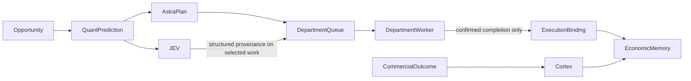

# Commercial decision identity continuity V2A

Purpose: preserve originating candidate/prediction identity across selected work
and independently verified outcome attribution. Phase 4 OBSERVE/offline extension.
Canonical owners: JEV for recommendation provenance; Astra Executive and existing
department queue for delegated selection; department worker for completed adapter
evidence; decision_identity for identity and binding; Cortex/Economic Memory for
verified outcome/explicit linkage. ACP buyer-state attempt receipts are a distinct
path, not department-work completion. No new store, bus, runtime or engine.

Interface: optional structured commercial decision provenance on plan/work items;
existing Quant prediction_ref is copied verbatim, absent remains None. Candidate
identity and immutable recommendation/state refs feed build_decision_identity.
Astra-generated selections are shadow-only. Non-shadow input requires separate
explicit selection_authority_ref; provenance never authorizes execution. Work ID
is the canonical task key. Current time/lease metadata never defines decision_ref.
Queue claim/selection/DONE alone does not establish execution. Only confirmed
allowlisted internal adapter completion can request bind_execution_evidence with
department_work:<id>. Proposal, queued coding work and execution dispatch remain
unbound. Shadow identities never bind. Completion uses the persisted leased work,
not caller-mutated identities. No commercial outcomes or causal refs are created.

Authority: all provenance execution_authority none. No DB migration, service
restart, production job execution, outbound/payment/traffic or authority expansion.
Cortex verification and Economic Memory explicit outcome/execution gates unchanged.
Execution: synchronous existing deterministic owners; existing queue locks,
deduplication, leases and atomic files unchanged. Invalid/conflicting provenance
fails closed. Missing source/state remains explicit failure for identity-bearing
work; legacy work without provenance remains compatible.
Observability: decision identity in existing work/result records and attribution.
Worker assignment: Codex sole builder; isolated focused tests/negative/replay
verification. Rollback: remove task-specific fields/hooks only, preserve all
pre-existing dirty work. Commercial value: attribution traceability, no new value
estimates. Promotion: CODE/OFFLINE only; live/canonical data/Founder verification
excluded and outstanding. Independent outcome linkage is required, not inferred.
