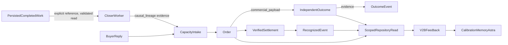

# Runtime causal lineage V2C — OBSERVE/offline

Owner: existing decision_identity/Department Work Queue own canonical identities;
closer_reply_worker and prepare_fulfilment_order_from_capacity own capacity orders;
record_commercial_outcome owns independent outcome truth; recognize_bsc_revenue
owns revenue truth; execution_bus_data_repository/outcome_feedback own scoped reads.
No new lineage table, bus, engine, outcome ledger or authority.

There is no automatic department-work → commercial execution transition. Existing
internal adapter completion alone does not produce orders/outcomes. A canonical
closer context must explicitly reference persisted work; absent remains absent.
The same immutable causal_lineage object carries known tenant/opportunity IDs,
prediction/decision/execution/selection/source/state references and truth flags.
It never grants authority. Context/caller claims must agree with persisted work.
Shadow/unexecuted work may preserve recommendation provenance but never execution.

Storage: capacity evidence → existing order commercial_payload.causal_lineage →
existing outcome evidence.causal_lineage → existing event payload.causal_lineage.
One pure contract, no hidden reasoning. Original work decision snapshot unchanged.
Conflict, malformed, cross-tenant or contradictory evidence fails closed; merging
preserves unrelated JSON. Idempotent outcome replay compares complete merged evidence.

SQL changes require a new HELD function/integrity-trigger migration, without new
tables or columns. No migration is applied;
018 remains untouched. Existing role grants, RLS and verification gates remain.
Pure lineage validation cannot authenticate filesystem evidence in PostgreSQL;
the governed Python producer resolves canonical work before writing. SQL enforces
structural consistency and immutable persisted lineage. JSON tenant provenance
does not replace existing database isolation or provide missing tenant authority.

Scoped repository handoff reads full independent order/outcome/payment/revenue
records through existing permitted canonical reads; no new grants. It validates
work/order/outcome/event lineage and calls V2B verified feedback, never treats a
projection as verified by itself. Missing read privileges/evidence fails closed.
Economic Memory uses explicit linked outcomes and genuinely bound execution.
Learning remains shadow; temporal availability checked at explicit as_of.

Execution: synchronous bounded canonical owners, existing locks/idempotency;
no new schedules, commands, retries, services or live state. References and
rejections are observability. Codex sole builder; isolated focused tests and
disposable socket-free SQL function fixtures verify. Rollback task additions
only; preserve all earlier dirty work. Purpose: traceable causal review, never
manufactured revenue or authority. Production rollout, independent canonical
data verification and governed learning promotion remain outstanding.

Existing Factory/Quant/JEV/Astra selection owners preserve supplied tenant and
opportunity UUID scope; missing scope stays None. Original prediction_ref and
decision identity algorithms are unchanged. task_key comes from the canonical
identity, including shadow work; it is not execution evidence.

Runtime handoff is available through the existing Economic Memory refresh with
an explicit canonical repository, tenant, bounded order IDs, as_of and original
prediction records. It invokes the full-record V2B adapter and existing calibration,
then writes the existing local memory snapshot consumed by Astra feedback. No
current schedule or default runtime path is switched to this scoped handoff.
Missing original prediction timing/horizon yields no invented calibration input.
Missing account identity retains existing outcome-memory retrieval rejection.

Migration 036 depends on the existing actual-cost hardening helper; deployment
state of that prerequisite is not assumed. No previous migration is edited or
applied. The order integrity trigger forbids changing/removing persisted lineage
while permitting unrelated commercial_payload merges.
