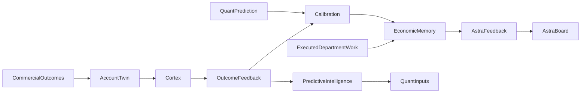

# Verified outcome learning V2B — Phase 4 OBSERVE

Canonical store/producer: EmpireDB commercial_outcomes and record_commercial_outcome,
append-only evidence records, distinct from revenue-recognized commercial_events.
Migration 029 recognition requires verified actual-cost evidence. No migration edits.
The current feedback projection omits outcome ID/evidence/tenant/decision linkage;
it cannot establish tenant-scoped lineage. Account Digital Twin already exposes the
canonical full outcome records to Cortex. Existing aggregate consumers assume the
restricted RPC projection is trusted; that legacy interface is not a scoped proof.

Owners: Cortex verifies commercial labels; outcome_feedback adapts full canonical
records to scoped learning; predictive_calibration joins an explicit original
probability prediction with its independently verified label using Quant Brier;
Economic Memory preserves separate outcome/calibration/causal/department types;
astra_feedback and observer consume scoped shadow evidence; predictive_intelligence
retains the existing Beta posterior mechanism for an explicitly scoped cohort.
No duplicate ledger, store, engine or runtime. Inputs never create outcomes.

Truth: canonical IDs/evidence refs, tenant, opportunity, prediction/decision/execution
refs remain explicit or unknown. Causal linkage requires matching persisted work,
canonical execution binding and explicit outcome linkage, never temporal proximity.
Prediction and actual values/times stay separate; unavailable timestamp/scope fails
closed for scoped calibration. Original prediction/decision snapshots stay immutable.
Won labels retain payment/fulfilment/recognized-revenue gates. Synthetic, mismatched,
unverified and future evidence cannot enter scoped learning. Unknown cost/margin
stays unknown. Account aggregates cannot masquerade as order-level realized economics.

Promotion: OBSERVED OUTCOME → VERIFIED OUTCOME → CALIBRATION EVIDENCE → LEARNING
CANDIDATE → SHADOW LEARNING. VERIFIED IMPROVEMENT and PROMOTED LEARNING require
separate governed proof/promotion; a test or a single outcome does not supply it.
All provenance authority none; no model weights, production strategy, outbound,
traffic, payment, execution or founder gates change. Existing cohort estimates and
Astra review recommendations may differ with verified historical evidence only.

Execution: synchronous pure read/review joins, existing files own optional snapshots;
deterministic identities exclude refresh clocks. Missing dependencies/scope degrade
to explicit rejection. Diagnostics/refs are observability. Codex sole scoped builder;
separate-process focused/negative/regression checks verify. Rollback task additions
only, preserve all V1/V2A/other dirty work. Operational value is traceable historical
learning and better review signals, not fabricated economics. CODE/OFFLINE only;
live canonical projection/scope ingestion and Founder proof remain outstanding.

Scoped opportunity normalization rejects both another tenant's cohort and an
unscoped cohort. No governed cross-tenant global aggregate is assumed. Legacy
unscoped candidates retain their existing interface.
